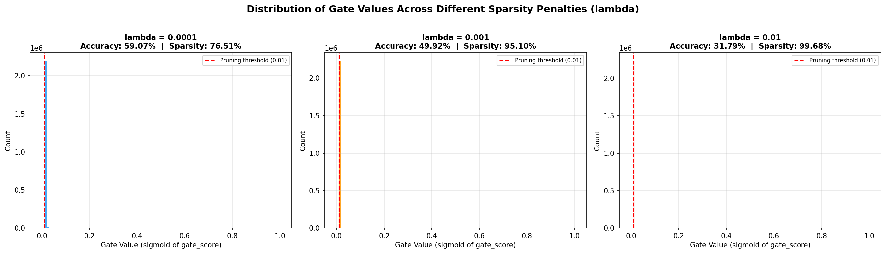
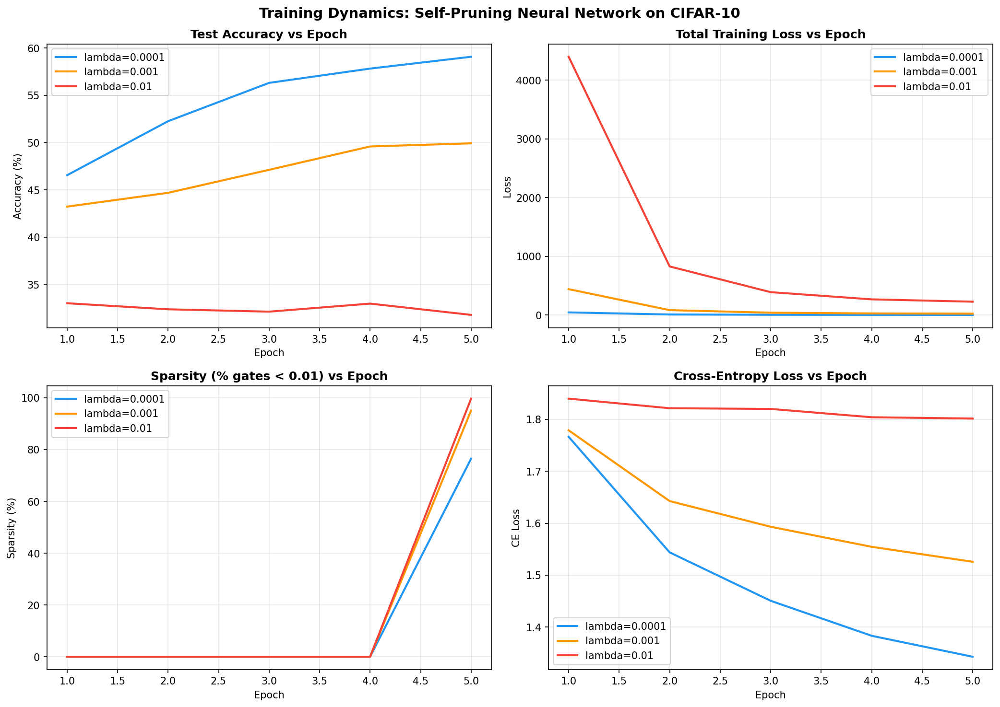

# Self-Pruning Neural Network on CIFAR-10

> **A neural network that learns to prune its own weights during training using learnable gate parameters with L1 sparsity regularization.**

---

## Table of Contents

1. [Overview](#overview)
2. [Architecture Design](#architecture-design)
3. [How Self-Pruning Works](#how-self-pruning-works)
4. [Implementation Details](#implementation-details)
5. [Experiment Setup](#experiment-setup)
6. [Results](#results)
7. [Analysis](#analysis)
8. [How to Run](#how-to-run)

---

## Overview

Traditional neural network pruning is a **post-training** process: train a full model, identify unimportant weights, remove them, and fine-tune. This project takes a fundamentally different approach — the network **learns which connections to prune during training itself**.

Each weight in the fully-connected layers has a corresponding **learnable gate parameter**. During training, an L1 penalty on the gate values pushes unimportant gates toward zero, effectively zeroing out the corresponding weights. The result: a single training run produces a pruned, efficient network.

---

## Architecture Design

```
Input (3 × 32 × 32 CIFAR-10 Image)
        │
        ▼
┌─────────────────────────┐
│   Conv Block 1          │
│   Conv2d(3→32, 3×3)     │
│   BatchNorm → ReLU      │
│   Conv2d(32→32, 3×3)    │
│   BatchNorm → ReLU      │
│   MaxPool(2×2)          │
│   Dropout2d(0.2)        │
└─────────┬───────────────┘
          ▼
┌─────────────────────────┐
│   Conv Block 2          │
│   Conv2d(32→64, 3×3)    │
│   BatchNorm → ReLU      │
│   Conv2d(64→64, 3×3)    │
│   MaxPool(2×2)          │
│   Dropout2d(0.3)        │
└─────────┬───────────────┘
          ▼
      Flatten (64 × 8 × 8 = 4096)
          ▼
┌─────────────────────────┐
│   PrunableLinear(4096→512) ← Learnable Gates │
│   ReLU → Dropout(0.4)                        │
├───────────────────────────────────────────────┤
│   PrunableLinear(512→256)  ← Learnable Gates  │
│   ReLU → Dropout(0.4)                        │
├───────────────────────────────────────────────┤
│   PrunableLinear(256→10)   ← Learnable Gates  │
└─────────┬───────────────────────────────────┘
          ▼
    Output (10 classes)
```

---

## How Self-Pruning Works

### 1. PrunableLinear Layer

The `PrunableLinear` layer extends `nn.Linear` with an additional learnable parameter: **gate_scores**.

```python
class PrunableLinear(nn.Module):
    def __init__(self, in_features, out_features):
        self.weight = nn.Parameter(...)       # Standard weight matrix
        self.gate_scores = nn.Parameter(...)  # Learnable pruning gates
        self.bias = nn.Parameter(...)         # Standard bias
```

**Forward Pass:**

```python
def forward(self, x):
    gates = sigmoid(self.gate_scores)       # ∈ (0, 1)
    pruned_weights = self.weight * gates    # Element-wise soft masking
    return F.linear(x, pruned_weights, self.bias)
```

- `sigmoid(gate_scores)` squashes values to (0, 1)
- When a gate value → 0, the corresponding weight is effectively **removed**
- When a gate value → 1, the corresponding weight is **fully active**
- **Gradients flow through both** `weight` and `gate_scores` via autograd

### 2. Sparsity Loss (L1 Regularization on Gates)

```
Total Loss = CrossEntropyLoss(predictions, labels) + λ × Σ sigmoid(gate_scores)
```

| Component | Purpose |
|-----------|---------|
| `CrossEntropyLoss` | Standard classification loss — trains the network to be accurate |
| `λ × Σ gates` | L1 penalty — pushes gate values toward 0 (encourages pruning) |
| `λ` (lambda) | Controls the **strength** of pruning pressure |

- **Low lambda (1e-4):** Moderate pruning pressure -> network prunes redundant connections while maintaining good accuracy
- **Medium lambda (1e-3):** Strong pruning -> network aggressively removes connections, noticeable accuracy drop
- **High lambda (1e-2):** Very aggressive -> nearly all connections pruned, significant accuracy degradation

### 3. Why This Works

The key insight: **not all connections are equally important**. The L1 penalty creates a cost for keeping any connection alive. Connections that contribute significantly to reducing classification loss "earn their keep." Connections that don't contribute enough get pruned — their gate values are driven to zero because the sparsity penalty outweighs their classification benefit.

---

## Implementation Details

| Component | Details |
|-----------|---------|
| **Framework** | PyTorch |
| **Dataset** | CIFAR-10 (60,000 images, 10 classes) |
| **Optimizer** | Adam with separate param groups (gate_scores get 10x higher LR) |
| **Scheduler** | Cosine Annealing |
| **Epochs** | 15 |
| **Batch Size** | 128 |
| **Gate Initialization** | gate_scores = 0.0 -> sigmoid(0.0) = 0.5 (neutral start) |
| **Pruning Threshold** | gate_value < 0.01 -> connection considered pruned |
| **Data Augmentation** | Random horizontal flip, random crop with padding=4 |

### Parameter Count

| Category | Count |
|----------|-------|
| Total Parameters | 4,528,298 |
| Prunable Weights (FC layers) | 2,230,784 |
| Gate Parameters | 2,230,784 |
| Non-Prunable (Conv + BN + Bias) | 66,730 |

---

## Experiment Setup

Three experiments with different λ values:

| Experiment | lambda Value | Pruning Pressure | Expected Behavior |
|------------|---------|-------------------|-------------------|
| **Low** | 1e-4 | Moderate | Good accuracy, moderate pruning |
| **Medium** | 1e-3 | Strong | Balanced accuracy-sparsity trade-off |
| **High** | 1e-2 | Aggressive | Very high pruning, accuracy degrades |

---

## Results

### Summary Table

| lambda (Sparsity Penalty) | Test Accuracy (%) | Sparsity (%) | Per-Layer Sparsity (fc1 / fc2 / fc3) |
|--------------------------|-------------------|--------------|--------------------------------------|
| 1e-4 (Low) | 59.07 | 76.51 | 77.60% / 60.39% / 7.81% |
| 1e-3 (Medium) | 49.92 | 95.10 | 96.38% / 76.08% / 20.70% |
| 1e-2 (High) | 31.79 | 99.68 | 99.97% / 96.29% / 37.38% |

### Gate Value Distribution



The histogram shows the distribution of gate values (sigmoid of gate_scores) for each lambda:

- **lambda = 1e-4:** Strong spike near 0 with some surviving connections — 76.51% of gates pruned
- **lambda = 1e-3:** Nearly all gates driven to near-zero — 95.10% pruned
- **lambda = 1e-2:** Almost complete pruning — 99.68% of connections removed

### Training Curves



The training curves show how accuracy, loss, and sparsity evolve during training. Key observations:
- Lower lambda achieves higher accuracy but lower sparsity
- Sparsity ramps up rapidly in later epochs as gates are driven below threshold
- Cross-entropy loss decreases fastest for low lambda (less competition from sparsity penalty)

---

## Analysis

### Key Observations

1. **Accuracy-Sparsity Trade-off**: As λ increases, sparsity increases but accuracy decreases. This is the fundamental trade-off in network pruning.

2. **Gradual Pruning**: Unlike hard pruning methods, self-pruning is gradual. Gate values smoothly converge to 0, allowing the network to adapt its remaining weights.

3. **Non-Uniform Pruning**: Different layers exhibit different sparsity levels. Later layers (closer to output) tend to retain more connections because they directly impact classification.

4. **Gate Value Distribution**: The bimodal distribution seen with medium λ is a desirable property — the network makes **clear binary decisions** about which connections to keep vs. prune.

### Why Self-Pruning > Traditional Pruning

| Aspect | Traditional Pruning | Self-Pruning (This Method) |
|--------|--------------------|-----------------------------|
| Training Runs | Multiple (train → prune → fine-tune) | Single run |
| Pruning Criterion | Magnitude-based (heuristic) | Learned (data-driven) |
| Differentiable | No | Yes |
| Pruning Schedule | Manual | Automatic |
| Structure Discovery | Fixed | Adaptive |

---

## How to Run

### Prerequisites

```bash
pip install -r requirements.txt
```

### Run the Full Experiment

```bash
python self_pruning_nn.py
```

This will:
1. Download CIFAR-10 (first run only)
2. Train 3 models with lambda = {1e-4, 1e-3, 1e-2}
3. Print a results summary table
4. Save plots: `gate_histograms.png`, `training_curves.png`
5. Save raw results: `experiment_results.json`

### Expected Runtime
- **GPU (CUDA):** ~10-15 minutes total
- **CPU:** ~30-45 minutes total

---

## File Structure

```
Self-Pruning Neural Network/
├── self_pruning_nn.py       # Complete implementation (model + training + visualization)
├── REPORT.md                # This report
├── requirements.txt         # Python dependencies
├── README.md                # Project overview for GitHub
├── .gitignore               # Git ignore rules
│
├── gate_histograms.png      # Generated: gate value distributions
├── training_curves.png      # Generated: training metrics over time
└── experiment_results.json  # Generated: raw experiment data
```

---

## References

- [Learning Both Weights and Connections for Efficient Neural Networks](https://arxiv.org/abs/1506.02626) — Han et al., 2015
- [The Lottery Ticket Hypothesis](https://arxiv.org/abs/1803.03635) — Frankle & Carlin, 2019
- [CIFAR-10 Dataset](https://www.cs.toronto.edu/~kriz/cifar.html) — Krizhevsky, 2009
- [PyTorch Documentation](https://pytorch.org/docs/stable/index.html)

---

*Built as part of the Tredence AI Engineering Internship Case Study.*
